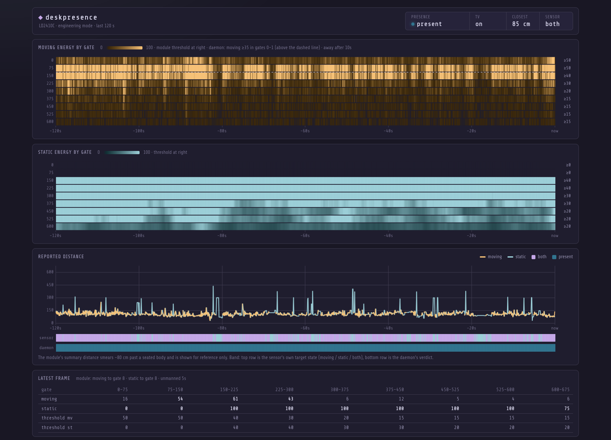
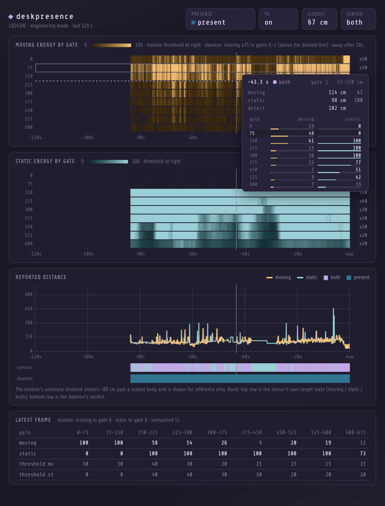

# deskpresence

LD2410C mmWave presence sensor that turns the TV off when you leave the desk and back on when you return.



Turns the TV off when nobody is at the desk and back on the moment someone
is. A 24 GHz mmWave presence sensor (Hi-Link LD2410C) on a USB UART feeds a
small Go daemon that owns the TV. Its rule, for an OLED whose life it is
guarding, is fail safe: when in doubt, the panel goes off.

## Why

    TV on  <=>  someone within reach of the sensor
                and the keyboard or mouse touched within the last hour

Bodies do most of the work, so a film keeps playing while you watch it and
the screen goes dark seconds after you walk away, even if a download is
still running. Under the radar sits conventional input idle, from
[hypridle](#input-idle-hypridle) with idle inhibitors ignored: an hour
without input turns the panel off whatever the radar says, so a radar that
misreads an empty room (it did, all night, on 2026-09-26) cannot keep the
panel lit. Input also covers for the radar: typing keeps the TV on even if
the sensor misses you, and a silent sensor hands the decision to input idle.

The daemon also fades PipeWire audio and pauses MPRIS players on the way
out, resumes them on the way back, and serves a live view of the sensor at
http://127.0.0.1:7391 for tuning.

## Hardware

| Part | Notes |
|---|---|
| Hi-Link LD2410C | 24 GHz mmWave, 5 V, UART at 256000 baud. The C variant has the 1.27 mm 5-pin header. |
| CP2102 USB to UART bridge | Needs a 5 V pin, not just 3.3 V. Any CP210x board works; the default `-port` glob matches it. |
| Four short leads | Enamelled speaker wire works and doubles as the mount. |
| Heat-shrink | For the two leads that cross. See assembly. |
| Optional 1.27 mm header | If you would rather not solder leads to the module. |

The module has no reverse-polarity protection. Check VCC and GND twice.

### Assembly

1. **Solder to the module.** The 5-pin edge is VCC, GND, OUT, RX, TX. OUT is
   the module's own presence pin and is not used. Solder either a header or
   four leads directly to VCC, GND, RX and TX.
2. **Cross the data lines.** UART is crossed: the bridge's transmit goes to
   the module's receive.

        CP2102 5V  -> LD2410C VCC
        CP2102 GND -> LD2410C GND
        CP2102 TXD -> LD2410C RX
        CP2102 RXD -> LD2410C TX

3. **Insulate the crossing.** With enamelled wire, RX and TX cross each other
   with nothing but enamel between them. Slip heat-shrink over each of those
   two leads before you bend anything into place. A bare crossing works until
   the enamel wears through, then the port goes silent for no visible reason.
4. **Power from 5 V.** The module regulates its own 3.3 V. Feeding it 3.3 V
   directly gives erratic frames or none.
5. **Mount and aim.** Stiff wire is enough to hold the module; a housing is
   not needed. The antenna patches (the flat side without components) face
   the chair, roughly at seat height and within 150 cm of it. Do not point it
   down a hallway or at a door.
6. **Plug in.** The bridge appears as
   `/dev/serial/by-id/usb-Silicon_Labs_CP2102_USB_to_UART_Bridge_Controller_*`.
   On Arch, add yourself to `uucp` if you get permission denied:

        sudo usermod -aG uucp $USER

## Install

From a clone (Go 1.27 or newer, per `go.mod`):

    go install .

### Run as a service

    install -Dm644 systemd/deskpresence.service -t ~/.config/systemd/user/
    systemctl --user enable --now deskpresence

On the laptop (the ToF sensor) install its unit under the same name:

    install -Dm644 systemd/deskpresence-tof.service ~/.config/systemd/user/deskpresence.service

### Input idle (hypridle)

hypridle reports input idle through `deskpresence input <level>`, which
writes `$XDG_RUNTIME_DIR/deskpresence.input`. Its listeners must ignore
idle inhibitors (per listener, `ignore_inhibit = true`, plus the general
`ignore_*_inhibit` options): an app holding one all night is exactly what
left the panel lit. A film longer than an hour takes `deskpresence hold 3h`.

Keep the quiet listener under the away timer (20 s against 30 s). Input
that counts as active keeps the TV on whatever the radar says, and no dim
is shown then, so a 60 s quiet made the real away timer a minute; the
screen dimmed at 30 s and then sat there.

    general { ignore_dbus_inhibit = true; ignore_systemd_inhibit = true; ignore_wayland_inhibit = true }
    listener { timeout = 20;   ignore_inhibit = true; on-timeout = deskpresence input quiet; on-resume = deskpresence input active }
    listener { timeout = 600;  ignore_inhibit = true; on-timeout = deskpresence input idle;  on-resume = deskpresence input active }
    listener { timeout = 3600; ignore_inhibit = true; on-timeout = deskpresence input away;  on-resume = deskpresence input active }

A level counts only while a process named `hypridle` is running, so a stale
"active" from a crashed hypridle cannot keep the panel lit. Run it as a
service that writes `active` on start and always restarts (an
`ExecStartPre=deskpresence input active` drop-in, `Restart=always`).

Nothing else should turn the TV on or off, or it will fight this daemon.
A watchdog on hypridle's 10-minute listener that blanks the TV only when
this daemon is dead (its status file is older than 15 s) is the one
exception worth having.

## Usage

    deskpresence -verbose            # print every frame
    deskpresence config show         # module parameters (daemon must be stopped)

Open http://127.0.0.1:7391 for the live view: two heatmaps (moving and
static energy by gate over the last 120 s), the reported distance, and a
band showing the sensor's own state against the daemon's verdict. The
dashed line on the moving heatmap is the daemon's near-gate boundary.
Hover anywhere for that frame's numbers, with the gate under the pointer
highlighted:



The module ships in basic mode. `deskpresence` switches it to engineering
mode on connect, so the gate data appears within a second.

While tuning:

    touch $XDG_RUNTIME_DIR/deskpresence.pause    # observe only, never act
    deskpresence hold 30m                        # same, but expires itself (`hold off` releases)
    deskpresence absence 45s                     # away timer, live, 10-60 s; `absence off` returns to -absence
    deskpresence input active                    # what hypridle's listeners run: active|quiet|idle|away
    echo off > ~/.local/state/deskpresence/audio-follow   # leave players and volumes alone
    deskpresence -dry-run -replay present:5s,absent:70s,present:3s -absence 60s
    cat ~/.local/state/deskpresence/status.json
    journalctl --user -u deskpresence -f

[docs/flags.md](docs/flags.md) lists every flag. `status.json` is what a bar
or chip reads; [docs/status.md](docs/status.md) describes its fields.

## Configuration

Edit the `ExecStart` flags in the unit to your calibrated values.

Thresholds depend on the chair, the distance and the room, so measure
rather than guess. [docs/calibration.md](docs/calibration.md) walks through
it with the live view, and records what was measured at this desk and how
the unit's values came from it.

## Integrations

Anything that should follow the desk can ride on `-hooks`. This unit runs
two, kept outside this repo: one turns the office light with the TV through
a local Kasa switch, the other plays a sound:

```
-hooks "%h/.config/deskpresence/light-hook {},%h/.config/deskpresence/emotune-hook {}"
```

Hooks run in parallel with the actuator and each other, are bounded to
30 s, and are never retried: presence is the truth, the log says what
failed.

A radar return within 2 min of the hooks' last `off` turns them `on` only
once presence has kept being renewed for 5 s. A radar phantom is two
frames and then nothing, and it used to flick the light on for the minute
the away timer took to run out again; a seated person renews every couple
of seconds. Input, a first arrival and `off` fire at once.

**Actuator.** Any executable taking `on` or `off`. It should serialise on its
own lock and write the state it achieved (`on` or `off`) to the `-state`
file, because the daemon trusts that file rather than remembering what it
asked for. The default, `tv-screen.sh` from
[dots](https://github.com/slastra/dots), talks to an LG TV over its IP-control
protocol, which avoids DPMS entirely (an NVIDIA FRL link that loses a
modeset race stays at 60 Hz until reboot).

**Bars and chips.** Read `status.json`. It changes only when something
changed, so polling it once a second is cheap.

## How it works

The LD2410C reports ten times a second, and the daemon reads only the moving
energy of the range gates that cover the chair, against a threshold it learns
from the empty room. A small policy combines that verdict with input idle and
the sensor's health, and a level-triggered loop keeps the TV in the state the
policy wants. [docs/architecture.md](docs/architecture.md) has the rules, the
decision table, the actuator contract, and the fade, blackout and alert
behaviour around the edges.

## Development

`go test ./...` covers the policy, the floor learner, the hook gate and the
parser, but not the tick loop in `main()`, which wires them together. It is
due to move into a struct the tests can drive, after a golden test that
replays a `-replay` scenario through it and pins the log.

## License

MIT © 2026 Shaun Lastra. See [LICENSE](LICENSE).
